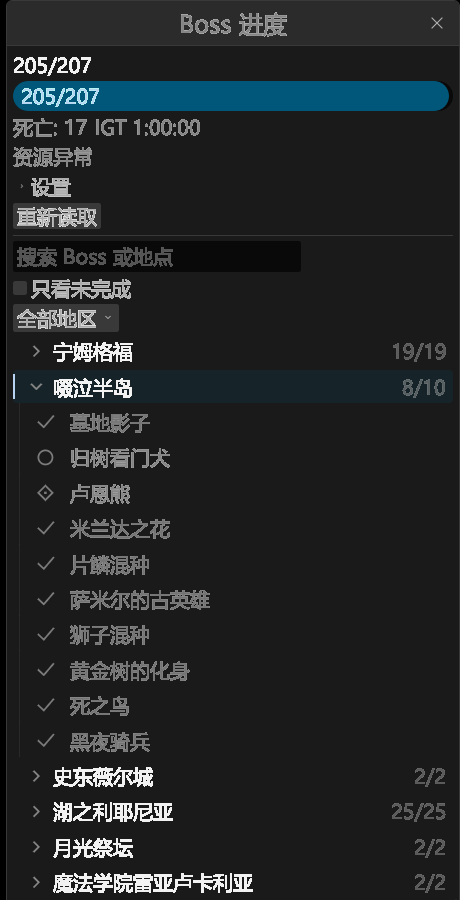

# Boss 列表状态样式

本轮基于 `daf3539`，代码提交为 `3ca251b942b4c588e28ed3fefe796aa72f7c21b6`，只调整 Boss 列表的局部视觉和相关窄窗口布局。207 场目录、32 大区、地区来源、自动折叠、搜索筛选、挑战与复活规则均保持。此前闪烁和菜单预加载仍待游戏现场确认。

## 显示与交互

- 地区标题使用细线矢量折叠符，名称与右侧全组进度分栏。当前游戏地区用细强调线和低饱和背景标记；展开、悬停和键盘焦点分别显示，不再整行使用黄色文字。
- Boss 状态位保持固定大小：空心圆为未击杀，勾为已击杀，带点菱形为未知。名称起点相同，已完成文字适度弱化。展开内容缩进并带细引导线。状态不只靠颜色区分。
- 地区标题的图标、名称和进度共用一个整行点击热区。浮动滚动条和窗口缩放边缘仍执行 egui 的原有交互。组计数不随搜索结果改变。
- 允许复活的已完成标记支持点击和 Tab／Space／Enter，悬停有轻量背景及操作说明。未击杀、未知、禁用或无有效配方／存档的标记不会打开确认窗口。确认和 update 侧重新授权没有改动。
- 名称和地区标题在剩余宽度内截断，完整文本仍可悬停查看。标记、标题行高和线宽使用 egui 逻辑尺寸并随字号、DPI 缩放；没有加入图标字体、贴图、依赖或持续动画。

窄窗口和 40 字号暴露了原来顶部提示换行挤压列表、总进度条文字被固定高度裁切的问题。资源状态改为单行摘要，失败仍以「资源异常」「数据不可用」「读取超时」明确显示，原完整说明保留在悬停提示中。「重新读取」按钮保留原操作和完整悬停名称。进度条高度随文字行高变化，不改变数值或资源错误状态。

## 验证范围

实际中文图片由 Boss DLL、真实游戏中文 FMG 和 WARP 渲染生成。资源来自本机游戏归档 `/msg/zhocn/`，通过生产 BND／FMG 读取器核验；没有使用旧多语言 JSON 或替换名称。存档、玩家地区、完成旗标、输入和 VFS 延迟由受控宿主提供，图片中的进度不是用户存档。观测版含测试故障钩子和只读控件记录，界面仍使用同一生产绘制路径；正式包不带这些测试导出。图片原件、裁剪范围和输入哈希见 [证据目录](evidence/boss-visuals-2026-11-03/README.md)。

- 根目录 fmt、check、严格 clippy、观测 feature clippy、Release 通过；默认 workspace 测试 **205 通过、0 失败、12 忽略**，不依赖外部游戏资产。[命令与源码哈希](evidence/boss-visuals-2026-11-03/checks.json)。
- 实际 egui 控件在 12／20／40 字号检查三态固定名称起点和长名称截断；20 字号另检查 1.5／2 倍 DPI。地区标题在 280／440 逻辑宽度检查整行热区、标题和进度分栏裁剪。
- 中文 DLL 轨迹覆盖配置宽度 440／20 字号、280／12／20／40 字号及关闭复活。通过实际鼠标点击左右两侧、Tab／Enter 折叠、状态悬停和焦点、键盘打开复活确认、禁用／未知点击不出确认且无写入。40 字号窄面板需要滚动；逐态通过真实滚轮使整个状态热区落入列表 clip 后再检查，不把底边裁切当作完整可见。[中文矩阵](evidence/boss-visuals-2026-11-03/chinese-final-07/receipt.json)。
- 最终正式 DLL 的名称 21 字形 UV 序列一致，三态首字形 x 均为 **890**。设置持久化、复活取消、仅早场完成的原写入集合、未知旗标及过期上下文拒绝、隐藏、重置、滚轮和重复序号回归通过。[正式 DLL](evidence/boss-visuals-2026-11-03/normal-final-09/receipt.json)。
- 观测 DLL 的 207 项主旗标／地图／完成集合／大区键逐项匹配上一轮审计；异步重读后记录相同。首次有效区、同区手动、unknown、筛选延期和无存档重读回归通过。具名成员审计沿用 [上一轮证据](boss-layout-regions-2026-11-03.md)，本轮发现、Param、事件及复活源码没有改变。[目录及折叠轨迹](evidence/boss-visuals-2026-11-03/feature-final-08/receipt.json)。
- 正式核心和两插件 WARP 装卸载 3 轮通过。复用源码未变的受控原生入口，真实两插件及共享 renderer 的 120 连续帧重叠像素检查通过。basic 压力场景含有意的 skip／恢复，共 8 次 drop，不将它重新表述为现场闪烁验收。[组合结果](evidence/boss-visuals-2026-11-03/verification.json)。

[悬停](evidence/boss-visuals-2026-11-03/images/hover.png)、[全部收起](evidence/boss-visuals-2026-11-03/images/collapsed.png)、[键盘焦点](evidence/boss-visuals-2026-11-03/images/keyboard-focus.png)、[窄面板大字号滚动](evidence/boss-visuals-2026-11-03/images/narrow-large.png)。图片仅做无损 BMP 转 PNG 和有记录的裁剪，没有重画或缩放。包内 `.full.png` 保留完整读回像素；原始 BMP 在本地探针目录保留，来源和哈希见组合结果。

该受控正式探针的紧凑 render CPU 中位数／p95 为 30／48 µs，完整列表为 192／277 µs；500 ms 进度更新中位数 33 µs、最大 53 µs。稳定样本没有文件请求或图集替换；GPU 提交和读回不计入 CPU 样本。这些值受宿主调度与采样负载影响，不作为与上一轮、C++ 同场景或游戏 FPS 的比较。新绘制只处理可视行，没有增加逐帧 IO、整目录扫描或排序。

正式 Boss 为 **2,770,944 字节**，比 `daf3539` 增加 24,064 字节，约 0.88%。核心、Minimap 与七份配置逐字节相同；完整 SHA-256 见组合结果。没有新增字体、运行时图片或依赖。

## 升级与复测

已经使用 `daf3539` 布局包时，仅需退出游戏后替换 `overlays/Boss.dll`。核心、Minimap 和七份模板／关系配置未变。保留现有配置、`configs/boss-ui.json` 和 `Challenge.txt`。从更早的包升级时，仍按上一轮地区服务要求更新核心和两插件。

按 `=` 打开列表，检查当前地区、折叠标题和三种状态；在已完成且启用复活的标记上悬停，核对确认窗口后取消。再检查跨区自动折叠、同区手动展开及窄窗口文本。未启动、注入或修改用户游戏；本轮美观、输入及此前闪烁／菜单预加载均保留现场复测状态。
