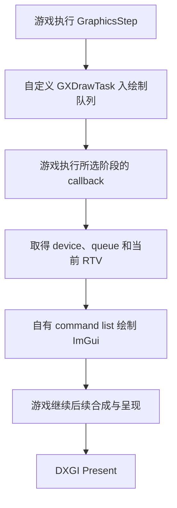

**libER 渲染接入调研，2026-10-16**

迁移结果：已按游戏 1.16 基线实现 `UI_SCENE`，复用现有 ImGui 和离屏渲染，完成多版本静态解析与真实 D3D12 受控验证。2026-10-16，用户确认游戏内测试全部通过后，已移除 DXGI hook 路径和后端选择配置。当前实现与范围见 [UI_SCENE 渲染说明](ui-scene-prototype.md)。下文保留迁移前的调研记录，其中旧 DXGI 实现、回退方案和默认后端建议均为历史分析，不是当前行为。

后续 shader 核对确认：libER 的 `HDR_SCENE` 所选 `render_post` 实际绑定为最终合成的 `UIScene` 输入，alpha 表示场景透过率。仅把普通 ImGui 绘制提前到该目标，不能保证透明度和 UI 下层遮挡正确；当前原型先完成 RGBA8 下层，再按透过率合到原生 UI 背后，见[下层透明度说明](ui-scene-prototype.md#下层透明度与原生-ui-遮挡)。

结论：libER 提供的游戏原生绘制任务可以作为 EROverlay 的另一种渲染入口，技术上能够替代当前图形 API hook。主要收益是选择游戏 UI 合成前后的绘制位置、减少对公共图形入口的拦截，以及直接取得游戏使用的 device 和 command queue。现有证据不足以支持直接替换默认后端，也不足以宣称能明显提高 FPS。

建议保留 DXGI 后端，先验证一个可选的原生绘制后端。优先借鉴 libER 的任务注册与绘制队列机制，复用现有 ImGui、纹理上传和离屏渲染；是否引入整个 libER，应由原型验证结果决定。

分析基线是 EROverlay `a669310eb1abf75966a0b10afb77103bed476d25`，以及本次从上游取得并核对远端 `main` 的 libER [`d8ae5c92719adca4344d8d902b63286b807f562b`](https://github.com/Dasaav-dsv/libER/commit/d8ae5c92719adca4344d8d902b63286b807f562b)。后者提交时间为 2025-04-24，对应 [PR #46](https://github.com/Dasaav-dsv/libER/pull/46)。以下区分源码事实、工程推断和待游戏验证的条件。最初调研阶段只分析代码与资料，没有构建、注入或运行替代后端；后续构建和受控验证结果见上方原型说明。

**迁移前的 EROverlay 拦截入口（现已移除）**

迁移前的 `D3DRenderer::hook()` 先找到游戏窗口，再创建临时 D3D12 device、queue 和 swap chain，从 COM vtable 取得实现地址，使用 MinHook 安装：

| 拦截入口 | 当时用途 | 安装期限 |
|---|---|---|
| `CreateSwapChain`、`CreateSwapChainForHwnd` | 发现交换链创建，并从传入参数取得实际 command queue | 持续安装 |
| `Present`、`Present1` | 调用原始 Present 前绘制 Overlay | 持续安装 |
| `ResizeBuffers`、`ResizeBuffers1` | 提前释放后缓冲引用和自有资源，随后重新绑定 | 持续安装 |
| `ExecuteCommandLists` | 未捕获 queue 时，取得一个 DIRECT queue | 捕获后撤销；需要重新捕获时再安装 |

因此是六个常驻 DXGI hook，加一个临时 D3D12 hook。不能把它描述为每帧一直拦截所有 command list 提交，也不能把临时设备创建算成稳态每帧开销。捕获 DIRECT queue 的回退路径只检查 queue 类型，绑定时再核对 device；这不等于证明该 queue 就是呈现交换链对应的 queue。这些队列捕获与绑定代码已随 DXGI 路径删除。

迁移前的绘制路径已经用 fence 检查 allocator 与 ImGui 环形缓冲是否可复用，忙时跳过绘制；空帧不提交绘制 command list。字体上传使用独立上传队列，纹理回收按 GPU 完成进度处理。这些机制继续保留在 [UI_SCENE 渲染器](../src/d3drenderer.cpp)和[纹理管理](../src/textureupload.cpp)中。因此，「换成 libER 就可以去掉每帧阻塞等待」不是本项目成立的收益论据。

**libER 如何进入游戏渲染链**

渲染入口是 [`from::GXBS::GXDrawTask`](https://github.com/Dasaav-dsv/libER/blob/d8ae5c92719adca4344d8d902b63286b807f562b/include/graphics/draw.hpp#L48)，继承游戏任务接口 `CSEzTask`，同时使用引用计数管理排队期间的对象寿命。

1. 调用 `register_task()`，把任务注册到 `CSTaskGroup::GraphicsStep`。游戏每帧执行这个任务组时调用任务。
2. `GXDrawTask::eztask_execute()` 从 `GLOBAL_GXDrawBase` 读取当前绘制队列，调用游戏自己的 `GXBS::GXDrawQueue::queue_callback`。
3. 游戏执行该绘制回调时，`liber_draw_callback()` 读取当前 device、queue、RTV、DSV、viewport、scissor 和 root signature，随后调用派生类的 `draw()`。
4. 使用者自行记录 D3D12 指令并提交到这个 queue。官方三角形示例自己创建 allocator、command list、PSO 和 vertex buffer，再调用 `ExecuteCommandLists`；没有把自定义绘制自动合入游戏现有 command list。

步骤 1 的实现见[任务注册](https://github.com/Dasaav-dsv/libER/blob/d8ae5c92719adca4344d8d902b63286b807f562b/source/coresystem/task.cpp#L10)，步骤 2、3 见[绘制队列与回调实现](https://github.com/Dasaav-dsv/libER/blob/d8ae5c92719adca4344d8d902b63286b807f562b/source/graphics/draw.cpp#L93)，步骤 4 见[三角形示例](https://github.com/Dasaav-dsv/libER/blob/d8ae5c92719adca4344d8d902b63286b807f562b/examples/d3d12/sample_triangle.cpp#L21)。

这里的渲染接入利用了游戏原有的回调机制，不需要为绘制修改 `Present` 或 `ExecuteCommandLists` 的函数入口。但也不能把完整接入概括成「完全没有 hook」：[`wait_for_system()`](https://github.com/Dasaav-dsv/libER/blob/d8ae5c92719adca4344d8d902b63286b807f562b/source/dantelion2/system.cpp#L35) 在系统尚未初始化时，会临时替换游戏窗口循环的 vtable 槽，回调后恢复。它与绘制队列接入是两个独立机制；晚加载且系统已初始化时会直接返回。

**两个绘制阶段的实际价值**

| libER 场景 | 上游定义的绘制位置 | 对本项目的意义 |
|---|---|---|
| `UI_SCENE`，内部 priority 为 `-2` | 游戏 UI 已合成之后，第三方 Overlay 之前 | 最接近现有 Overlay 的显示位置，适合作为首个原型 |
| `HDR_SCENE`，内部 priority 为 `-1` | 游戏 UI 合成之前，输出到场景目标 | 可让游戏菜单覆盖 Overlay；需要处理场景目标的格式和颜色空间 |

层级语义来自[接口注释](https://github.com/Dasaav-dsv/libER/blob/d8ae5c92719adca4344d8d902b63286b807f562b/include/graphics/draw.hpp#L50)，priority 和目标选择来自[实现](https://github.com/Dasaav-dsv/libER/blob/d8ae5c92719adca4344d8d902b63286b807f562b/source/graphics/draw.cpp#L93)。这些是两个特定接入阶段，不代表能任意插入游戏 HUD 内部各元素之间；同任务组内的任务顺序也[没有保证](https://github.com/Dasaav-dsv/libER/blob/d8ae5c92719adca4344d8d902b63286b807f562b/include/coresystem/task.hpp#L37)。

对小地图而言，UI 前绘制的价值是让菜单自然覆盖整张小地图。小地图内部 Boss、玩家、地标等标记的相互层级仍由现有游戏规则决定，无需因此调整。

`HDR_SCENE` 名称也不代表自动兼容显示器 HDR。示例明确提醒场景使用 HDR 颜色空间，却把 PSO 的 RTV 格式固定为 `R8G8B8A8_UNORM`；不能直接照搬来证明 SDR/HDR、透明度和场景亮度均正确。相关信息见[示例 PSO](https://github.com/Dasaav-dsv/libER/blob/d8ae5c92719adca4344d8d902b63286b807f562b/examples/d3d12/sample_triangle.cpp#L106)与[场景说明](https://github.com/Dasaav-dsv/libER/blob/d8ae5c92719adca4344d8d902b63286b807f562b/examples/d3d12/sample_triangle.cpp#L183)。

**为什么不能直接把 `renderFrame()` 挂到 `draw()`**

| 现有依赖 | libER 当前公开接口 | 需要的适配 |
|---|---|---|
| `IDXGISwapChain3`、后缓冲索引与数量 | 没有公开交换链或索引 | 增加桥接信息，或把自有帧资源改为独立 fence 环形槽 |
| 后缓冲 resource 与自建 RTV | 只给游戏当前 RTV handle | 使用当前回调借用的 RTV，明确资源状态及有效期 |
| `PRESENT → RENDER_TARGET → PRESENT` | 回调在游戏绘制阶段内 | 按阶段约定处理；不能沿用 Present 前的状态转换 |
| ImGui PSO 的 RTV format | 没有目标格式 getter | 取得并验证实际格式；场景目标、最终目标分别处理 |
| resize/device loss 的提前通知 | 没有对应生命周期回调 | 定义 device、目标世代和尺寸变化处理，避免持有游戏后缓冲引用 |
| 卸载时停止 Present detour | 原生任务与绘制 callback 可能已排队 | 先停止新入队，等待 CPU 回调退出和 GPU 完成，再卸载代码 |

公开字段范围见 [`draw.hpp`](https://github.com/Dasaav-dsv/libER/blob/d8ae5c92719adca4344d8d902b63286b807f562b/include/graphics/draw.hpp#L104)。原 `renderFrame()` 已删除，离屏回调与资源释放保留在 [D3DRenderer](../src/d3drenderer.cpp)。libER 在内部识别了交换链持有者，但未把该指针作为公开 getter 提供。继续调用 DXGI 查询接口，并不要求继续安装 DXGI hook；「取消 hook」和「不再使用 DXGI」应分开判断。

最关键的未验证条件是游戏 callback 两侧的真实 GPU 提交顺序与目标状态。源码中的示例说明了预期用法，但没有公开游戏内部的 command list flush 和状态转换契约；`liber_draw_callback()` 返回 `false` 对游戏状态缓存的具体含义也需进一步核对。仅凭拿到 RTV，不能假定前面的游戏指令已提交、后面的合成一定等待自定义绘制。D3D12 要求应用保证资源状态转换一致，参见[微软资源屏障说明](https://learn.microsoft.com/en-us/windows/win32/direct3d12/using-resource-barriers-to-synchronize-resource-states-in-direct3d-12)。

GPU 完成进度仍由本后端负责。上游示例每次复用同一个 allocator，却没有显式 fence 等待或完成检查，不能作为通用的生产同步方案；是否存在游戏侧隐含等待，需要实测或继续分析。微软明确要求 allocator 在关联 GPU 工作结束后才能 Reset，见 [`ID3D12CommandAllocator::Reset`](https://learn.microsoft.com/en-us/windows/win32/api/d3d12/nf-d3d12-id3d12commandallocator-reset)。现有 frame fence、ImGui 缓冲复用检查、上传队列和纹理延迟回收应继续保留。

小地图离屏绘制本身可以复用：仍在自有 command list 中切到局部纹理，结束后恢复当前游戏 RTV。需要把离屏资源索引从「实际后缓冲索引」中解耦，或从桥接层补齐索引；不能无 fence 地轮用三张纹理。ImGui 后端也按调用次数轮用顶点缓冲，见[本地实现](../deps/imgui/imgui_impl_dx12.cpp#L224)。

**版本兼容与依赖成本**

libER 当前 `main` 将 CSV 地址通过 [`symbols.hpp`](https://github.com/Dasaav-dsv/libER/blob/d8ae5c92719adca4344d8d902b63286b807f562b/include/detail/symbols.hpp#L76) 编译进二进制，按模块基址加 RVA 访问。绘制实现另外固定了 `GXDrawBase` 的 environment、swap chain、绘制队列等成员偏移，以及 viewport/scissor 偏移；这些不是通过运行时扫描取得的。

README 宣称分版本符号和可自动更新符号，但当前构建没有提供该说明所描述的运行时更新链路；不能把这段宣传作为升级兼容保证。当前源码依据是[符号表](https://github.com/Dasaav-dsv/libER/blob/d8ae5c92719adca4344d8d902b63286b807f562b/symbols/file_list.inl)、[地址访问](https://github.com/Dasaav-dsv/libER/blob/d8ae5c92719adca4344d8d902b63286b807f562b/include/detail/base_address.hpp)和[构建目标](https://github.com/Dasaav-dsv/libER/blob/d8ae5c92719adca4344d8d902b63286b807f562b/CMakeLists.txt)。PR #46 的分支名包含 `1.16`，也不能据此证明 1.16.1、1.16.2、1.17 或当前 Steam EXE 可直接使用。

本项目已有[历史版本适配记录](minimap-version-compatibility.md)和[扫描研究](minimap-scanner-design.md)，覆盖范围比这套单一渲染地址表宽。现有扫描研究针对文件、菜单和地图数据，不能直接视为已经定位了 `GXDrawBase` 与 `queue_callback`。新后端需要单独定位并验证绘制相关地址、结构和调用约定，未知版本应在调用游戏代码前停止启用。

完整引入 libER 还有以下边界：

- 编译器方向相容：libER 要求 C++20 以上和 MSVC STL，本项目使用 C++23/MSVC。但 Debug 的游戏 ABI 边界要求 `_ITERATOR_DEBUG_LEVEL=0`，需让 libER 与适配代码的布局一致。依据见[上游构建文件](https://github.com/Dasaav-dsv/libER/blob/d8ae5c92719adca4344d8d902b63286b807f562b/CMakeLists.txt#L1)。
- 项目要求不使用异常；libER 的引用计数错误路径存在 `throw std::runtime_error`。直接纳入需要明确处理这个差异，见[引用计数实现](https://github.com/Dasaav-dsv/libER/blob/d8ae5c92719adca4344d8d902b63286b807f562b/include/dantelion2/utility.hpp#L80)。
- 任务注销不是立即取消当前帧：`free_task()` 的接口说明允许本轮继续执行，见[任务生命周期说明](https://github.com/Dasaav-dsv/libER/blob/d8ae5c92719adca4344d8d902b63286b807f562b/include/coresystem/task.hpp#L105)。引用计数保护对象寿命，并不保证 DLL 中的虚函数、callback 和 deleter 代码可立即卸载。
- 插件绘制 ABI 可以保留，[`pluginsRender()`](../src/plugin.cpp#L106)继续在单一绘制入口调用即可。Win32 输入/WndProc 与菜单鼠标控制仍需保留，原生绘制入口不会自动替代它们。
- 取消图形 hook 不等于项目不再需要 MinHook；[Achievements](../src/achievements/data.cpp#L54)还有自己的 Steam 成就 hook。若复制或修改 libER 代码，还需按其 [Apache 2.0 with LLVM exception 许可](https://github.com/Dasaav-dsv/libER/blob/d8ae5c92719adca4344d8d902b63286b807f562b/LICENSE)保留相应声明。

**预期收益与实际限制**

| 维度 | 可以成立的收益 | 限制与判断 |
|---|---|---|
| 游戏 UI 层级 | 获得 UI 合成前后的明确接入点 | 收益最明确；HDR 阶段另有格式与颜色空间工作 |
| 图形 hook 兼容 | 原生路径可撤销六个 DXGI detour 与临时 queue 捕获 hook | 减少在这些公共入口与其他 Overlay/包装层交互；不能保证与所有 Mod 兼容 |
| 队列识别 | 从游戏当前绘制环境直接取得 queue | 避免首个 DIRECT queue 的猜测；仍依赖内部布局正确 |
| 初始化 | 可以省掉为取得函数地址而创建的临时窗口和图形对象 | 主要影响启动及重试，不能换算成稳态 FPS 收益 |
| CPU/GPU 帧开销 | 可能省掉部分 hook 分发和最终目标状态转换 | 仍需自有 command list、提交、fence、ImGui 和纹理工作，原生任务也有分发成本 |
| 版本维护 | 可以把渲染入口收敛到少量游戏对象与函数 | 对游戏内部地址和 ABI 的依赖比当前 DXGI 入口更强，维护成本可能上升 |

不能承诺零额外提交、零同步成本、自动 HDR 正确、完全无 hook 或确定的 FPS 提升。源码支持的是入口与层级能力，性能收益和第三方兼容收益需要对照测量。

**建议的原型及替换条件**

第一步只实现 `UI_SCENE`，优先证明同一份 ImGui 内容能在正确阶段稳定显示。DXGI 与原生后端共用插件分发、纹理服务和离屏逻辑，每次只允许一个后端绘制。启动前解析或验证失败时选择 DXGI；已经注册任务后切换，必须先完成原生任务和 GPU 工作的退出，不能只修改一个开关。

原生桥接层至少要明确 device、queue、当前 RTV、实际目标格式、viewport、目标世代，以及帧资源复用规则。优先借用游戏当前 RTV，避免长期持有游戏后缓冲资源，否则可能阻塞游戏自己的 `ResizeBuffers`。自有 allocator、ImGui 缓冲和离屏纹理继续通过 fence 管理；不要把游戏任务的引用计数当作 GPU fence。

| 原型验证 | 可据此决定什么 |
|---|---|
| 记录 callback 与游戏 command list 的提交顺序，确认资源状态和阶段语义 | 原生绘制是否正确进入合成链，是否能撤销 Present/resize hook |
| 矩形与透明圆形小地图、旋转、动态图集、12 图集与纹理回收 | 现有渲染和资源服务能否完整迁移 |
| 窗口/全屏、分辨率、最小化恢复、SDR/HDR、设备与目标重建 | 生命周期与显示模式能否稳定处理 |
| 已排队任务期间关闭 Overlay 和卸载 DLL | 注销、在途回调、延迟销毁和 GPU 资源退出是否完整 |
| 相同场景分别测 DXGI 与原生路径：隐藏、正常显示、纹理流入三种负载 | 比较整体帧时间分布、Overlay CPU 时间、GPU 时间和提交数量，而非只比较两个不同位置的回调耗时 |
| 支持范围内历史 EXE 的独立定位与校验，再做代表版本游戏验证 | 是否达到当前项目的版本覆盖要求 |

在上述条件通过前，保留 DXGI 为默认是收益与维护成本更平衡的选择。若原型证明它能解决具体的图形 hook 冲突，或确实需要让游戏菜单覆盖小地图，则原生后端有明确价值；若唯一目标是提高 FPS，现有证据尚不足以支持为此迁移整个 libER。
