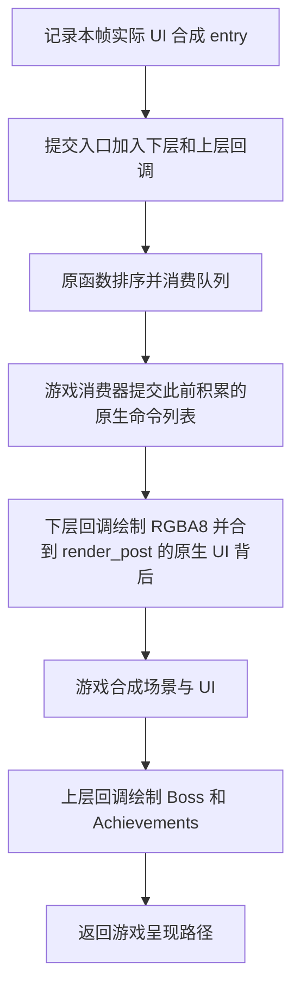

# UI_SCENE 渲染

2026-10-16。参考游戏版本为 1.16，libER 参考提交为 [`d8ae5c9`](https://github.com/Dasaav-dsv/libER/tree/d8ae5c92719adca4344d8d902b63286b807f562b)。UI_SCENE 复用 EROverlay 的 ImGui、插件绘制、纹理上传、fence 和离屏渲染，通过两个游戏内部 hook 记录 UI 合成边界并接入绘制队列。用户确认游戏内测试全部通过后，已移除 DXGI hook 路径及后端选择配置；UI_SCENE 是唯一渲染方式。

已完成 Release 构建、多版本 EXE 静态解析，以及真实 D3D12 设备上的提交顺序、交换链缩放和 HWND 重建验证。用户提供的 HDR 游戏日志进一步确认：在 3440×1440 下，主目标与交换链均为 `format=24`，离屏为 `28`，首次绘制已提交 350 个顶点、1473 个索引。按此次实测收敛 UI_SCENE：主目标使用 RGB10A2，离屏保留 RGBA8。日志证明实际提交，颜色和亮度仍需观察游戏画面；静态解析通过也不代表对应游戏版本已经实测。完整记录见 [ui-scene-evidence.json](ui-scene-evidence.json)。

## 使用与诊断

更新 DLL 后自动使用 UI_SCENE。需要查看诊断日志时，在 DLL 旁的 `configs/common.ini` 中设置，随后重启加载器或游戏：

```ini
console=true
```

成功时控制台显示 `UI_SCENE enabled`，以及动态解析出的入口 RVA。随后前 4 次队列处理显示入队、回调、原函数返回的顺序；目标初始化或重建时显示 `UI_SCENE generation N`、尺寸、主目标格式、交换链格式、离屏格式和 HWND。首次提交可见几何时显示 `UI_SCENE first draw submitted`，可与「回调被消费」区分。

同时更新 `EROverlay.dll` 和 `overlays/Minimap.dll`。Boss、Achievements 可以继续使用旧版 DLL。加载 Minimap 时，正常日志应包含 `below-ui before native UI composition`，以及 `consumed 2 callback(s) (below-ui=1 above-ui=1)`；首次可见绘制分别标记 `layer=below-ui` 和 `layer=above-ui`。仅加载上层插件时仍只有一个绘制回调。

旧配置中的 `common.renderer` 不再读取，可以删除。启动解析或 hook 安装未通过时不绘制 Overlay，日志显示具体原因；运行中遇到暂时无效的目标会跳过绘制。遇到 `unsupported target format` 时记录实际格式，以便对照游戏目标和管线。

渲染器接受单采样、viewport 原点为 `(0, 0)` 的借用 RTV。最终主目标仍限定为此前实测的 RGB10A2；下层借用合成前的 UI 纹理，其 alpha 表示场景透过率：

| 目标 | DXGI 值 | 离屏目标 |
|---|---|---|
| UI 上层／最终主目标 `DXGI_FORMAT_R10G10B10A2_UNORM` | 24 | RGBA8，使用独立 PSO |
| UI 下层 `render_post`，RGB10A2 或 RGBA8 | 24 或 28 | RGBA8，整层完成后合到原生 UI 背后 |

`24` 是每个 RGB 通道 10 位、alpha 2 位的归一化格式，见 [Microsoft 的 DXGI_FORMAT 定义](https://learn.microsoft.com/en-us/windows/win32/api/dxgiformat/ne-dxgiformat-dxgi_format)。此前按 RGBA8 限制直接返回，因此日志中的「consumed 1 callback」并不表示实际提交了绘制。

离屏纹理保留 RGBA8，避免跟随主目标改成 RGB10A2 后把小地图的透明度降为 2 位。ImGui 后端分别创建主目标与离屏目标的 linear/nearest PSO，离屏 begin/end 同时切换 RTV 和 PSO；共用 shader 和 root signature，保留局部投影和采样状态。退出或目标重建时一并释放这些管线。

此前测试和 HDR 日志中的主目标均为 `24`。下层目标与最终主目标不同，支持 RGBA8 不改变最终主目标的格式范围。HDR 开关不等同于存储格式变化；格式本身不足以决定 PQ、色域或亮度转换。下层的颜色仍由游戏显示映射处理，日志不提供 HDR 亮度和色域的定量结果。

## 下层透明度与原生 UI 遮挡

用户报告 HDR 关闭时，90% alpha 在 UI_SCENE 下比 DXGI 更透明。核对 1.16 的合成调用和本机游戏资源 `Data0.bdt` 中的 `GXShader.shaderbnd.dcx` 后，确认 `render_pre` 绑定为 `HDRScene`，`render_post` 绑定为 `UIScene`。`GXSimple_BlendUI_SDR2SDR_F.ppo` 的实际计算为：

```text
output.rgb = pow(scene.rgb * ui.a + ui.rgb, outputGammaForSDR)
output.a   = 1
```

`ui.rgb` 是预乘颜色，`ui.a` 是剩余场景透过率。普通 ImGui 的 alpha 混合会写入不透明度；在原生 UI 的透明区域，初始透过率为 1，普通混合后仍为 1，场景便没有按 Overlay 的 alpha 衰减。直接在这张纹理上按普通方式绘制，也不能保证原生 UI 覆盖小地图。

下层现在先完整绘制到自有 RGBA8 纹理，保留插件内部的正常绘制顺序和小地图的局部离屏回调。整层完成后，再使用独立 PSO 合到已存在的游戏 UI 背后：

```text
ui.rgb += lower.rgb * ui.a
ui.a   *= 1 - lower.a
```

其中 `lower.rgb` 已经预乘 alpha，合成 shader 不再重复乘 alpha。RGB 混合使用 `DEST_ALPHA / ONE`，alpha 混合使用 `ZERO / INV_SRC_ALPHA`。因此不透明原生 UI 保持原样，半透明原生 UI 按剩余透过率显示下层；最后仍由游戏完成场景和 UI 合成。上层插件继续使用原有 source-over 混合方式。

新增纹理按 viewport 分配一张 RGBA8 表面，在同一 DIRECT queue 上依次复用，不增加每帧 CPU 等待。3440×1440 时约占 18.9 MiB，另有一次整层合成 draw；实际 GPU 帧时间需要测量。目标重建或卸载时随 renderer 释放，空下层不分配、不合成。RGBA8 保留整层绘制过程的 8 位 alpha；合入游戏目标之后的精度仍由游戏目标格式决定，若原生 UI 目标实际为 RGB10A2，最终透过率仍有 2 位量化限制。

受控检查使用默认 SDR gamma `1`，分别覆盖 100%、90%、50%、20%、0% alpha，以及透明、半透明、不透明原生 UI。可通过 `--ui-compositor` 加载本机提取的原始游戏 shader，游戏资源不提交到仓库。检查同时覆盖重叠命令、局部离屏、窗口重建前后的纹理生命周期。

## 插件层级与显示条件

新增可选 DLL 导出，保留 `PluginExports` 和旧 `EROverlayAPI` 的布局：

```cpp
PLUGIN_EXPORT ERRenderLayer getRenderLayer() { return ER_RENDER_LAYER_BELOW_UI; }
```

缺少导出、返回 `ER_RENDER_LAYER_ABOVE_UI` 或未知值时都使用 UI 上层。只有 Minimap 导出下层选择，旧版 Boss、Achievements 无需重编译。`createRenderer()` 原有返回值继续决定插件回调顺序，不用于选择游戏合成阶段。接口说明见 [writing-plugins.md](writing-plugins.md#rendering-below-game-ui)。

每个游戏队列只构建一个 ImGui/input frame，所有插件的 `render()` 各调用一次。[DrawLayers](../src/drawlayers.hpp) 按插件标记绘制命令，再分别提交两层，支持共享窗口、背景／前景 draw list 和离屏回调。字体、输入边沿和动画不因双阶段而更新两次。纹理使用的 fence 覆盖上层最后一次提交，避免下层完成后提前回收上层还要用的 SRV。

Minimap 的游戏状态自动隐藏只保留加载／Logo 和游戏全屏地图两类。绘制入口先调用独立的 `readDisplayState()`，再处理纹理、地图快照和资源提示。加载判断读取 `LoadingScreenData` 和 LoadingScreen／NowLoading 控制位；Logo 同时检查原生菜单栈中的 `LogoMenu` RTTI，不依赖固定 vtable 地址。全屏地图读取 WorldMapDialog 的活动位，普通菜单打开不再隐藏小地图。手动隐藏和禁用预设仍有效。

用户随后报告启动黑屏／Logo 阶段仍出现「正在等待游戏资源」和圆形边框。离线复现确认：角色指针已分配、菜单仍是全零或部分构造状态时，旧代码会因加载标志为零而允许显示。当前先通过运行时 RTTI 校验 `CSMenuManImp` 和内嵌 `LoadingScreenData` 已构造，再要求菜单 owner／view 已发布；未构造的根菜单也不能当作「非 Logo」。读取结束前复核对象身份，遇到初始化、失效或替换中的状态返回不可验证，并保留默认隐藏结果。整张小地图、资源提示和边框一起暂缓绘制，不依赖资源准备完成、update 快照或固定启动延时。

## 接入与提交顺序

[UiSceneBridge](../src/uiscene.cpp) 拦截原生 UI 合成函数，记录它本次实际追加的 command entry、索引和编码优先级；另一个 hook 拦截绘制队列提交入口。提交前重新核对该 entry，使用游戏自己的 `queue_callback` 把下层回调放在合成 entry 前，上层回调仍使用 `0xFFFFFFFE`（libER 的 `UI_SCENE`）。游戏可以在合成之后追加其他原生命令，不影响已记录的边界。

不能把队列的最后一条 native entry 直接当成 UI 合成，也不能在提交入口使用 `-1` 猜测下层顺序：`-1` 会按当前队列最大值生成新的编码优先级。如果没有确认本帧合成 entry，跳过下层并记录 `below-ui skipped`，上层继续工作。

两个绘制回调均在本次原提交函数返回前消费，因此不需要实现或注册 libER 的 `CSEzTask` 对象，也没有跨帧排队的绘制回调需要注销。合成 hook 只记录队列边界，不在其中绘制或等待 GPU。



1.16 的消费器在 opcode 2 回调前检查积累的 command list 数量，非零时先调用 native batch flush，再调用回调函数。后端沿这条 flush 调用链获取同一条 DIRECT queue；GPU 顺序由同队列的提交顺序保证，不通过每帧 CPU 等待游戏 GPU 工作实现。

优先级按无符号数排序，`-1` 还有引擎自己的编码规则。因此不能按负数大小推断执行顺序，也不能把 `UI_SCENE` 简称为「在场景收尾回调之前」。目标阶段沿用 [libER 的 `UI_SCENE` 定义](https://github.com/Dasaav-dsv/libER/blob/d8ae5c92719adca4344d8d902b63286b807f562b/include/graphics/draw.hpp#L50)：游戏 UI 已合成之后。与其他使用相同优先级的 Mod 之间没有顺序保证。

[D3DRenderer::overlayScene()](../src/d3drenderer.cpp) 接收借用的 device、queue、RTV、格式、viewport 和交换链，用共享的 `renderCommands()` 调用现有插件。上层借用最终主 RTV，下层沿用 libER `HDR_SCENE` 的 `render_post->cg_view`，按 UI 透过率规则混合。原型不持有游戏 back buffer 引用，也不对借用目标插入 `PRESENT ↔ RENDER_TARGET` barrier；目标必须由游戏保持在可绘制状态。这是沿用 libER 阶段语义的前提，仍需在实际游戏图形模式下确认。

Overlay 保留自有 command list、allocator、上传队列、fence 和离屏纹理。回调返回 `false`，因为它没有修改游戏自有 command list 的缓存状态。此后端安装两个游戏内部 hook；渲染接入不再安装 DXGI 或 `ExecuteCommandLists` hook，仍通过 DXGI 接口查询窗口和交换链描述。

## 地址定位与版本范围

[运行时解析器](../src/util/uiscenescan.hpp) 与[离线检查器](../tools/ui_scene_scan_verify.cpp) 共用一份逻辑：

- 唯一匹配队列提交函数，从相对调用取得入队、排序、执行和消费入口。
- 校验入队函数、消费器完整控制流，以及消费器到 native `ExecuteCommandLists` 的调用关系。内部跳转保留在特征中；跨函数地址操作数使用通配符。
- 通过 MSVC x64 RTTI 查找 `DLCG3::CGRenderTargetView` 和 `DLCG3::CGTexture2D` 的主 vtable，并在回调中检查实际对象。
- 从已匹配指令的操作数提取 swap chain、viewport、环境对象和 queue 字段偏移；从 RTV 工厂调用取得引擎像素格式转换函数。
- 完整校验 UI 合成函数及其 native entry 入队函数，从操作数读取 `render_post`、队列索引和队列数组偏移，并检查合成到入队的直接调用关系。
- 启动时有任一缺失、歧义或调用关系不符就拒绝安装渲染 hook，不绘制 Overlay。

运行时没有按版本写死函数 RVA 表。仍保留 `GXSwapChain::main_render_target_view`、CGView 等少量 ABI 字段偏移；这些来自 1.16 的 libER 布局和 EXE 对照，配合 RTTI、工厂特征及运行期资源检查使用，不表示能自动兼容任意布局变化。

本机归档共 29 个目录、28 个不同 SHA-256 的 EXE；其中 `1.13` 与 `1.13.2` 的文件相同。

| 范围 | 解析结果 | 说明 |
|---|---|---|
| 1.05、1.06、1.07、1.08、1.08.1、1.09、1.09.1、1.10、1.10.1 | 通过 | 仅静态检查 |
| 1.12、1.12.3、1.13、1.13.2、1.14、1.15、1.16、1.16.1、1.16.2、1.17、1.17.1 | 通过 | 仅静态检查 |
| 1.02、1.02.1、1.02.2、1.02.3、1.03、1.03.1、1.03.2、1.04、1.04.1 | 不绘制 Overlay | 场景 begin callback 与参考特征不同；未放宽匹配 |

1.16 离线证据包括：submit RVA `0x19EADF0`、enqueue RVA `0x1AEA960`、consumer RVA `0x1AEAC50`；这些值只用于复核分析，不参与运行时地址选择。参考 EXE SHA-256 为 `5d0b85d2bb86b61632705023690b3bd5c4d0bae06308db2eed50849bd37db611`。

## 生命周期

后端按 device identity、queue、交换链、交换链尺寸／格式和 buffer 数量检查绑定变化。下层／上层切换借用目标不会触发重建。必要时等待 Overlay 已提交的 GPU 工作完成，销毁并重建插件 renderer 和自有资源；ImGui 字体保留在 context 中，后端重新上传字体，避免每次重建重复加载字体。

每个游戏帧最多产生两次 Overlay 提交，allocator 和 ImGui 顶点／索引缓冲共用容量为 `2 * BufferCount` 的提交环及一份 fence 记录。下层开始前同时检查下一槽，给上层留出位置；仅有一槽可用时，上层仍可构建并提交本帧，下层跳过，不等待 GPU。各离屏 context 只保留一张纹理，读写都在同一 DIRECT queue 中排序；纹理替换和销毁继续通过 fence 延迟回收。整层下层目标直接保存资源，不再借用完整离屏 context。

`WM_NCDESTROY` 标记原窗口已销毁。下次有效回调遇到新窗口或复用的 HWND 时，重建 Win32 绑定和 WndProc，再恢复绘制。游戏窗口仍存在时忽略辅助窗口的目标。

启动仅在窗口尚未就绪时重试。原生签名或 hook 安装失败后结束初始化，清理插件和资源，不再每 500 ms 重建渲染器并重扫 EXE。插件的 `destroyRenderer()` 只针对已创建的渲染世代执行一次；未创建、已销毁和重复清理均不会再次分发。正常卸载先销毁渲染器，再执行插件 `uninit()`，最后清理文件服务和 hook 库。

退出先停止新回调入队并禁用 hook，再通过共享/独占锁等待已有的同步队列调用返回，最后移除 trampoline、销毁 renderer 并等待自有 GPU 资源退出。已进入 detour、但尚未取得锁的线程可转调恢复后的游戏入口，避免使用已销毁的 bridge。实际游戏内卸载整个 DLL 的行为仍属于待验证范围。

## 已完成验证

使用 Release 生产代码和真实 D3D12 设备运行 [ui_scene_render_verify.cpp](../tools/ui_scene_render_verify.cpp)，开启 D3D12 debug layer 和 GPU-based validation。工具将 warning/error 计为失败，UI_SCENE 检查返回 0。透明度参考使用 UI 上层的 source-over 绘制，无需保留已删除的 Present 路径。

| 检查 | 结果 |
|---|---|
| 真实 MinHook 安装、在途同步回调退出、恢复原入口及再次安装 | 通过，使用受控队列夹具 |
| 游戏前置清屏 → Overlay 红块 → 游戏后续蓝块 | 像素读回符合顺序；Overlay 与后续提交间不等待 Overlay 的 GPU fence |
| 无内容时不提交绘制、可见内容时提交、动态图集字号更新 | 通过 |
| 64×64 半透明离屏合成、结束离屏后恢复主 RTV | 绿色混合和主目标黄色像素均符合预期 |
| RGB10A2 游戏主目标 | 像素、离屏、resize 和 HWND 重建检查均通过 |
| 低透明度离屏像素 | RGBA8 alpha 精度保留，RGB10A2 主目标不会把离屏透明度降到 2 位 |
| 用户提供的 HDR 游戏日志 | 3440×1440，主目标及交换链为 24，离屏为 28；350 顶点、1473 索引已提交 |
| 640×360 / 3 buffers → 800×450 / 2 buffers | `ResizeBuffers` 成功；没有提前释放 renderer 或通知它，下一帧自动重建 |
| 销毁 HWND，创建新 HWND 和 720×400 交换链 | 重建后文字、离屏合成、前后绘制顺序和字体数量均正确 |
| 窗口销毁后退出 renderer | 正常清理；不向已销毁或已被复用的旧 HWND 恢复 WndProc |
| 无游戏签名且旧配置仍含 `renderer=dxgi` | 初始化返回，不绑定设备、不安装回退渲染 hook、不反复扫描 |
| 小地图 → 游戏 UI → 上层插件 | RGB10A2 像素读回符合顺序；共享窗口及背景／前景 draw list 按命令分层 |
| 仅含 ImGui 回调的独立 draw list | 下层与上层回调各在所属阶段执行一次，不因缺少顶点被丢弃 |
| 双阶段 ImGui 与插件回调 | 每帧一个 ImGui frame，每个插件各一次 `render()` |
| GPU 阻塞时连续排入 3 个双阶段帧 | 旧容量只提交 3/6 层；修复后完整提交 6/6 层，无 CPU 等待 |
| GPU 只完成最早一次提交，仅余一槽 | 上层使用该槽；绿色像素读回正确，不额外构建 ImGui frame |
| 未创建和重复销毁插件 renderer | 旧代码分发 3 次；修复后仅有效世代销毁 1 次 |
| 上层纹理在构建帧时退休 | 下层提交完成后仍保留，供上层实际采样；上层完成后回收 |
| RGBA8 下层目标与 RGB10A2 最终主目标交替 | 通过；不重复重建 renderer，保留离屏回调后的目标恢复 |
| SDR 下层透明度及已存在的游戏 UI | 100/90/50/20/0% alpha 与 source-over 参考符合；透明、半透明、不透明原生 UI 的遮挡关系正确 |
| 下层整层纹理的 resize／HWND 重建 | 旧世代纹理释放，新世代重新分配并保持透明度 |
| 每个离屏 context 复用一张纹理 | 局部／全屏绘制、非零原点、透明度、缩放、独立 context 及描述符回收通过 |
| 合成之后追加原生命令 | 仍使用记录的精确边界；过期、缺失边界只跳过下层 |
| 旧插件缺少层级导出、返回未知值 | 默认 UI 上层，`PluginExports` 大小不变 |
| 资源尚未加载时的状态窗口 | 加载／Logo／全屏地图立即隐藏；其他菜单可见，不等待 update 快照 |
| 启动时指针非空但状态未初始化 | 全零菜单、未构造 LoadingScreenData、未发布 owner／view、根菜单构造中和状态失效均为零绘制顶点；旧代码在这些用例中各输出 48 个顶点 |
| 三种历史菜单布局的初始化判断 | `menuOwner=0x78/0x80`、`ownerView=0x248/0x250` 及各自 MenuInfo 偏移下，初始化前隐藏，初始化后资源等待提示可见 |
| 重复入口特征、改写入队调用、消费控制流变化、RTTI 缺失、PE 截断 | 解析器均拒绝 |
| 模拟 PE 加载器的 DIR64 relocation，基址移动 8 GiB | RTTI 和函数解析结果保持一致 |

复现命令（仓库根目录，需匹配现有构建目录的 VS/v142 工具链）：

```powershell
cmake --build build --config Release --parallel 4
cmd /d /c tools\build_ui_scene_checks.bat
.\build\ui-scene\ui_scene_scan_verify.exe D:\Games\EldenRingExe\1.16\Game\eldenring.exe --negative
.\build\ui-scene\ui_scene_render_verify.exe
# 可选：使用从本机资源提取的原始 SDR 合成 shader
dxc -T vs_6_0 -E main tools/ui_scene_compositor_verify.hlsl -Fo build/ui-scene/ui_scene_compositor_verify.vso
.\build\ui-scene\ui_scene_render_verify.exe --ui-compositor build/ui-scene/ui_scene_compositor_verify.vso build/ui-scene/game-shaders/GXSimple_BlendUI_SDR2SDR_F.ppo
.\build\ui-scene\minimap_visibility_verify.exe
.\build\ui-scene\minimap_map_verify.exe
.\build\ui-scene\plugin_thread_verify.exe
.\build\ui-scene\minimap_texture_verify.exe --offscreen
python tools/ui_scene_evidence.py D:\Games\EldenRingExe --output build/ui-scene/evidence.json
```

`build_ui_scene_checks.bat` 编译检查工具，复用 `build/` 的 Release 对象和库；它不会启动游戏。可从 x64 Native Tools 命令行运行，或由脚本通过 `vswhere` 查找 VS 并初始化 v142。

验证记录中的 `source_sha256` 先将 CRLF 统一为 LF，再计算源码字节的哈希，避免 Git 换行设置影响复核。EXE 和 shader 哈希仍按原始字节计算。

## 游戏内验证与后续范围

2026-10-16，用户确认此前列出的游戏内测试全部通过，并要求移除 DXGI 路径及对应配置。此前检查范围包括透明度、普通菜单对小地图的覆盖、启动黑屏／Logo／加载时隐藏提示、全屏地图隐藏、旧版 Boss／Achievements 层级，以及窗口和分辨率变化。本次删除后继续使用相同 UI_SCENE 接入与混合方式，并通过离线渲染和状态回归；删除后的 DLL 尚未再次进行游戏内复测。

现有验证不提供 HDR 亮度／色域和帧时间收益的定量结果，也不覆盖任意第三方 Overlay／图形 Mod、设备丢失与恢复。静态解析通过的历史游戏版本仍需分别进行游戏内测试。
